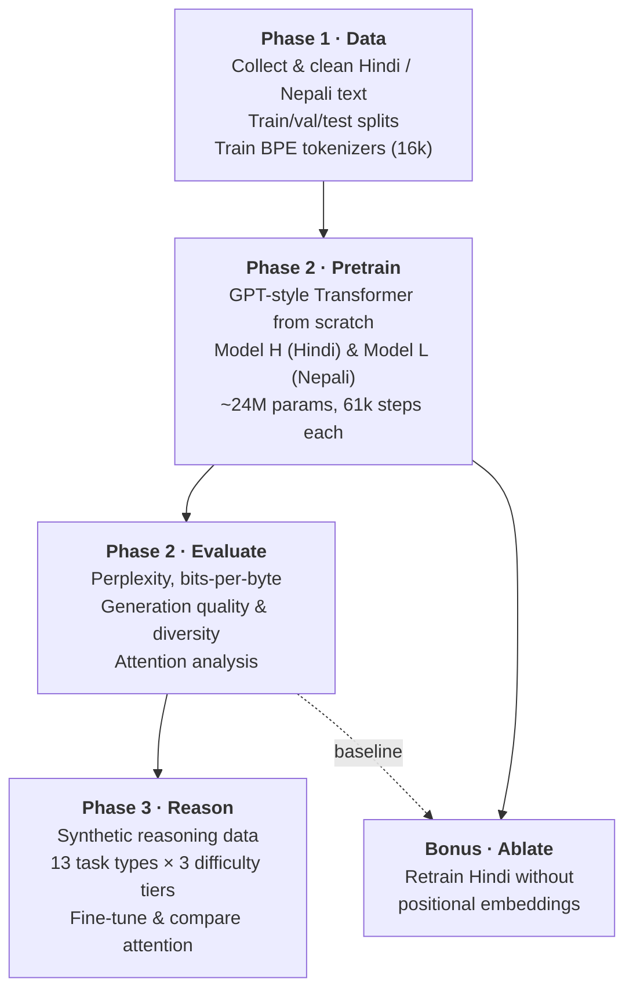
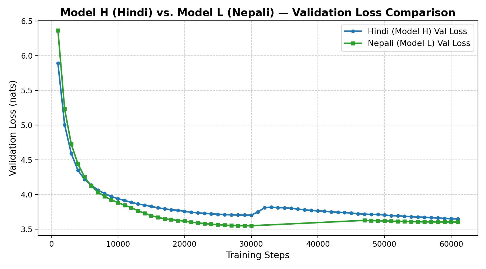

# Hindi & Nepali Language Models, From Scratch

This project builds two small monolingual GPT-style language models, one for **Hindi** (higher-resource) and one for **Nepali** (lower-resource). It then fine-tunes them on synthetic reasoning tasks and tests what happens when position information is removed.

### What "from scratch" means here

Everything below the PyTorch tensor level was written and trained in this project:

- **Data:** the corpora were collected and cleaned here (scraping, raw dumps, OCR sources for Nepali). No pre-built training dataset is reused as-is.
- **Tokenizers:** a custom BPE tokenizer was trained for each language (16k vocabulary). No pretrained tokenizer is used.
- **Model code:** the decoder-only Transformer is implemented directly in PyTorch: token and learned positional embeddings, multi-head causal self-attention (`QKᵀ/√d_k` + causal mask), pre-LayerNorm blocks, GELU feed-forward and weight tying. It does **not** use Hugging Face model classes or `nn.Transformer`.
- **Weights:** both models start from random initialisation. No pretrained checkpoint is loaded or fine-tuned in Phase 2.
- **Reasoning data:** the Phase 3 fine-tuning set is generated synthetically by our own scripts.

Each model has about 24M parameters: 6 layers, 8 heads, `d_model` 512, FFN 1536, context length 512.

## Phases



## How to run

Use Python 3.10+. A CUDA GPU is recommended for training.

```bash
python -m venv .venv && source .venv/bin/activate
pip install -r requirements.txt -r phase3/requirements.txt
```

### Phase 1: data and tokenizers

Raw corpora are not included in the repo. Put your source text under each language's `datasets/raw/` folder first. To skip this phase, use the checked-in tokenizers in `phase2/tokenizers/`.

```bash
# (optional) Hindi news scraper
python phase1/hindi/collection/main.py --help

# Clean and split
python phase1/hindi/preprocessing/prepare_dataset.py
python phase1/nepali/preprocessing/prepare_dataset.py

# Train BPE tokenizers
python phase1/hindi/training/train_tokenizer.py \
  --corpus-dir phase1/hindi/datasets --vocab-size 16000 \
  --test-file phase1/hindi/datasets/test.txt
python phase1/nepali/training/train_tokenizer.py --vocab-size 16000
```

### Phase 2: pretrain and evaluate

The trainer reads tokenized `uint16` `.bin` splits from the paths in `BIN_MAP` in [phase2/src/dataset.py](phase2/src/dataset.py). These default to Kaggle paths (`/kaggle/working/{hindi,nepali}_{train,val,test}.bin`), so edit them for a local machine. The `.npy` output of `phase1/pretokenize.py` is not interchangeable with these `.bin` files.

```bash
cd phase2

python src/train.py --config config/model_h_config.json \
  --tokenizer tokenizers/hindi_tokenizer_16000.json \
  --dataset manyajain111/hindi-lma-corpus --output_dir checkpoints/hindi

python src/train.py --config config/model_l_config.json \
  --tokenizer tokenizers/nepali_tokenizer_16000.json \
  --dataset manyajain111/nepali-lma-corpus --output_dir checkpoints/nepali

python src/evaluate.py --checkpoint checkpoints/hindi/<checkpoint>.pt \
  --tokenizer tokenizers/hindi_tokenizer_16000.json \
  --dataset manyajain111/hindi-lma-corpus --language hindi \
  --output_dir reports/hindi
```

Useful training flags are `--max_steps`, `--batch_size` and `--resume latest`. Run `python src/train.py --help` to see all of them. To evaluate Nepali, swap in the Nepali tokenizer and dataset and pass `--language nepali`.

### Phase 3: reasoning fine-tuning

```bash
python phase3/scripts/generate_reasoning_dataset.py \
  --n_train 6300 --n_val 1350 --n_test 1350 --seed 42
python phase3/scripts/generate_easy_test.py
```

This writes JSONL splits to `phase3/data/{hi,ne}/`. Next, run [phase3/notebooks/phase3_reasoning_finetuning.ipynb](phase3/notebooks/phase3_reasoning_finetuning.ipynb) with the checkpoint and data paths pointed at your Phase 2 checkpoints.

### Bonus: positional-embedding ablation

Run [bonus_training_final.ipynb](phase3/notebooks/bonus_training_final.ipynb) to train the ablated model, then [bonus_eval_final.ipynb](phase3/notebooks/bonus_eval_final.ipynb) to evaluate it. Set the model and data paths for your runtime first.

## Key results

### Pretraining (held-out test set)

| Metric | Hindi (Model H) | Nepali (Model L) |
|---|---|---|
| Test loss (nats) | 3.666 | 3.592 |
| **Perplexity** | **39.11** | **36.32** |
| **Bits per byte** | **0.513** | **0.394** |
| Avg bytes / token | 10.31 | 13.16 |
| 4-gram repetition (greedy) | 26.6% | 67.1% |

Nepali reaches a slightly lower perplexity even though it had less data. Its tokenizer packs more bytes into each token. Its greedy generations loop far more, which points to a less diverse corpus.



### Reasoning fine-tuning (substring match)

| | Hindi | Nepali |
|---|---|---|
| Pretrained baseline | 1.04% | 1.93% |
| **After fine-tuning** | **27.26%** | **26.67%** |
| Tier 1: direct comparison | 38.98% | 37.50% |
| Tier 2: transitive | 18.50% | 17.45% |
| Tier 3: structural | 31.95% | 34.49% |
| Easy 60-item test | 50.00% | — |

A prediction counts as correct when the gold answer appears as a substring of the generated text. Strict exact match is 0% because the models keep generating past the answer. Overall accuracy is close to chance for multi-hop tasks, which is expected for a 24M-parameter model trained on 6.3k examples. The 50% score on direct comparisons shows the models do pick up simple comparative logic.

### Bonus: removing positional embeddings (Hindi)

| Metric | With positions | Without positions |
|---|---|---|
| Perplexity | 39.11 | **58.54** (+49.7%) |
| Bits per byte | 0.513 | 0.567 |
| Distinct-1 | 0.427 | 0.170 |
| 4-gram repetition | 26.6% | **68.5%** |

Without position information, self-attention cannot tell token order apart. Loss plateaus around 4.1 nats, generations fall into loops, and the diagonal local-attention patterns disappear.

Full write-ups: [Phase 2 report](report/report.md), [Phase 3 report](report/phase3_report.md), [Ablation report](report/bonus_report.md) and [consolidated PDF](report/individual_project_report.pdf). Plots are in [report/plots/](report/plots).
