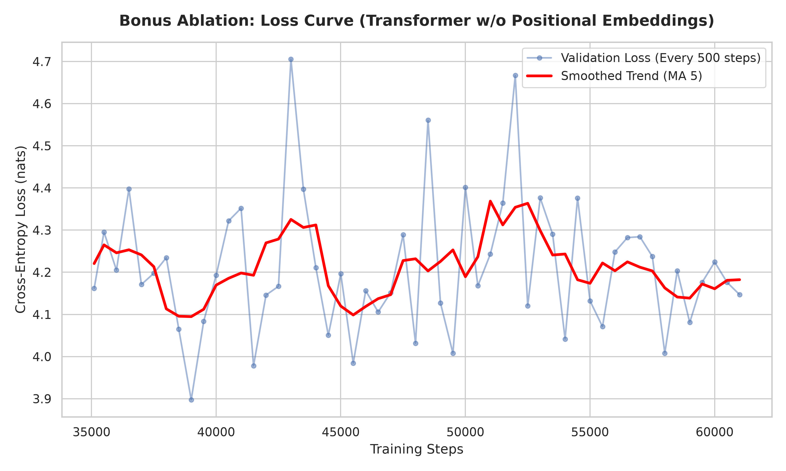
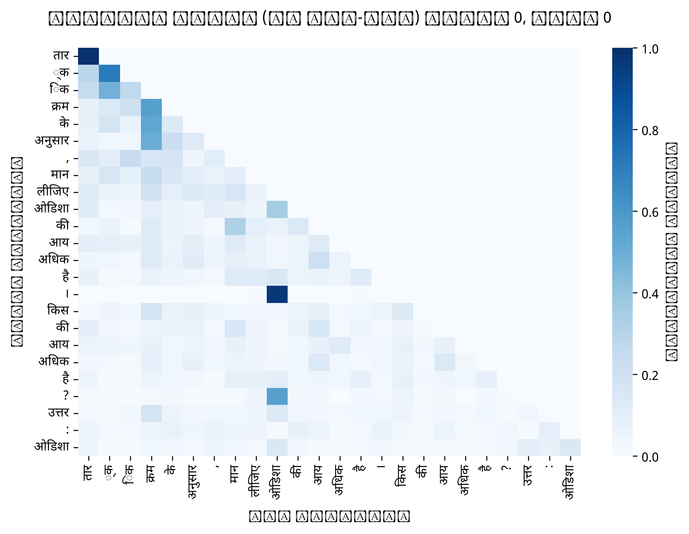
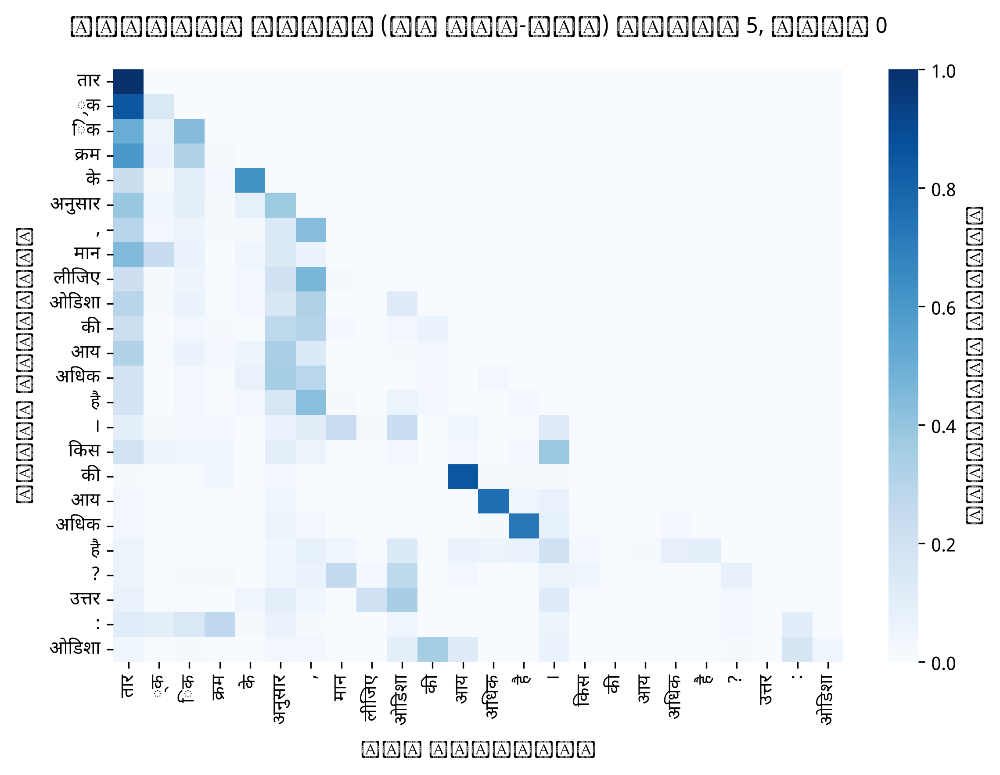

# Bonus: Ablation Study (No Positional Embeddings)

To isolate the impact of position information, we retrained the Hindi model with absolute positional embeddings entirely removed from the architecture. Trained for **61,036 steps** (same compute budget as the standard model). See `phase3/bonus_training_final.ipynb` for training code and `phase3/bonus_eval_final.ipynb` for evaluation.

## Ablation Results

| Metric | Standard Hindi (With Positions) | Ablated Hindi (No Positions) | Relative Impact |
|:---|:---|:---|:---|
| **Validation Loss** | 3.6487 | **4.0697** | +11.5% higher loss |
| **Perplexity (PPL)** | 39.11 | **58.54** | **+49.7% degradation** |
| **Bits-Per-Byte (BPB)** | 0.5131 | **0.5674** | +10.6% worse |
| **BLEU-4** | 0.95 | 1.08* | Near-zero (vs greedy) |
| **chrF** | 12.21 | 11.28 | — |
| **Distinct-1** | 0.4270 | **0.1703** | Vocabulary collapse |
| **Distinct-2** | 0.62 | **0.2412** | — |
| **4-gram Repetition** | 26.59% | **68.52%** | Severe looping |

*Note: While the ablated model technically scores a slightly higher BLEU-4 (1.08) compared to the standard model (0.95), both are effectively near-zero stochastic noise and do not represent a meaningful improvement in generation quality.*

### Training Loss Curve (Bonus Ablation)

The ablated model's loss plateaus around **4.14–4.17 nats** throughout training (vs the standard model converging to 3.65 nats). It never decreases meaningfully because the self-attention mechanism, without any position signal, is completely permutation-invariant and cannot learn to distinguish "dog bites man" from "man bites dog."

## What Breaks Without Position Information?

1. **Severe Perplexity Degradation**: The model loses its inductive bias for sequence order. Sentences become purely a "bag of words" to the attention heads, driving Perplexity up from 39.11 to 58.54 (+49.7%).

2. **Infinite Looping (Degeneration)**: Without position information, the model has no concept of "progress" through a sentence. `Distinct-1` vocabulary usage drops to 0.17 (from 0.43), and 4-gram repetition spikes to **68.52%**. The model gets stuck outputting the same high-probability token loops endlessly.

3. **Attention Collapse**: In the ablation attention heatmaps (`report/ablation/`), the typical diagonal "local attention" lines completely vanish. Because every token lacks a position identifier, attention heads smear weights uniformly across the sequence or collapse into static patterns, destroying the model's ability to track syntax. See `report/ablation/attn_entropy_distance.png` for quantitative entropy and mean-distance analysis.

4. **Generation Metrics Collapse**: ROUGE-L drops to 0.0000 (greedy mode), confirming the ablated model cannot produce even marginally coherent continuations of reference sentences. chrF at 11.28 indicates the character n-grams match only superficially (the model still generates plausible-looking Devanagari characters, just in completely random order).

### Attention Heatmaps (Layer 0 Early — Standard vs Ablated)

| Standard Hindi | Ablated Hindi (No Positions) |
|:---:|:---:|
| Diagonal focus, local syntactic binding | Lower-triangular causal constraint only, no structural locality |

See `report/ablation/attn_layer0.png` and `attn_layer5.png`.

